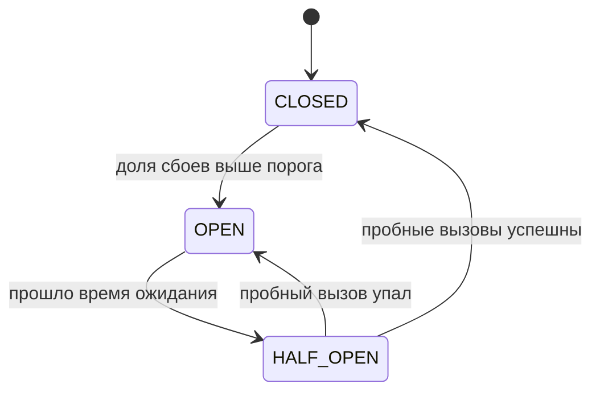

# 4. Circuit Breaker

Если сервис недоступен, повторы только ухудшают ситуацию: каждый вызов ждёт таймаут, нагрузка на
больной сервис растёт. Размыкатель **перестаёт стучаться** на время, отвечая отказом мгновенно.



| Состояние | Что происходит с вызовами |
|---|---|
| `CLOSED` | проходят как обычно, ведётся статистика сбоев |
| `OPEN` | **не доходят** до сервиса: сразу исключение (быстрый отказ) |
| `HALF_OPEN` | пропускается несколько пробных вызовов: успех -> `CLOSED`, сбой -> снова `OPEN` |

Пример настройки в Resilience4j (в проекте библиотека не подключена — иллюстрация):

```java
CircuitBreakerConfig config = CircuitBreakerConfig.custom()
        .failureRateThreshold(50)                          // открыть при 50 % сбоев
        .waitDurationInOpenState(Duration.ofSeconds(30))   // 30 с держать открытым
        .permittedNumberOfCallsInHalfOpenState(3)          // 3 пробных вызова
        .build();
```

| Параметр | Что регулирует |
|---|---|
| `failureRateThreshold` | при какой доле сбоев размыкаться |
| `waitDurationInOpenState` | сколько не пускать вызовы, прежде чем попробовать снова |
| `permittedNumberOfCallsInHalfOpenState` | сколько пробных вызовов делать, чтобы решить «сервис ожил» |

Retry и Circuit Breaker дополняют друг друга: retry справляется с **единичными** сбоями, размыкатель —
с **затяжным** отказом, когда повторять бессмысленно.
