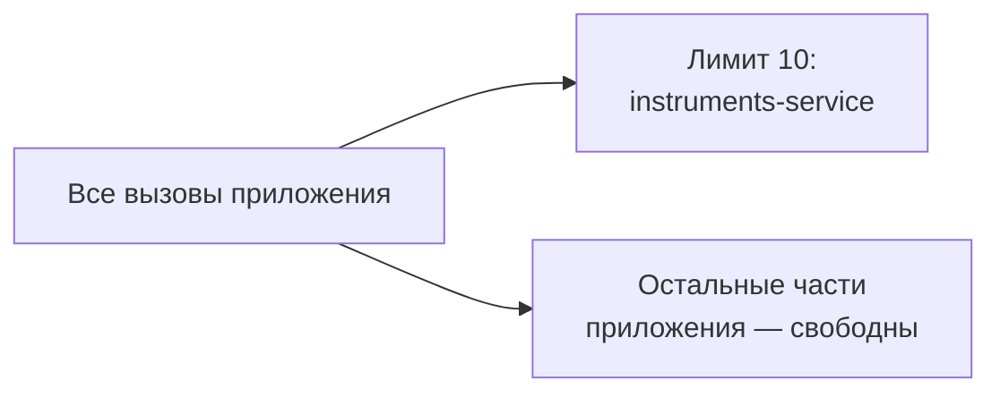

# 5. Bulkhead и Fallback

## Bulkhead — переборки: сбой одного не топит остальное

Ограничить число одновременных вызовов к одному сервису, чтобы его проблемы не исчерпали все потоки
приложения.

```java
Semaphore permits = new Semaphore(10);                     // не больше 10 параллельных вызовов

List<Quote> fetchLimited() {
    if (!permits.tryAcquire()) {
        throw new TInvestApiException("Слишком много одновременных вызовов instruments-service");
    }
    try {
        return client.fetchQuotes();
    } finally {
        permits.release();
    }
}
```



## Fallback — вернуть что-то осмысленное вместо ошибки

В нашем проекте запасной источник уже есть — котировки, сохранённые на диске
(`FileBackedQuoteRepository`):

```java
List<Quote> quotesOrCached() {
    try {
        return client.fetchQuotes();                       // свежие данные из сети
    } catch (TInvestApiException e) {
        return fileBackedQuotes.all();                     // последние сохранённые на диске
    }
}
```

| Вариант запасного ответа | Когда подходит |
|---|---|
| Последние закешированные данные | данные могут слегка устареть (котировки: допустимо с пометкой) |
| Значение по умолчанию | безопасное «пусто» (например, пустой список) |
| Явная ошибка пользователю | устаревшие данные опасны (баланс, подтверждение сделки) |

Всё вместе (порядок вложенности — от внешнего к внутреннему):

| Слой | Задача |
|---|---|
| Fallback | что вернуть, если всё остальное не помогло |
| Circuit Breaker | не стучаться, если сервис явно лежит |
| Retry | пережить единичный сбой |
| Bulkhead | не дать сбою расползтись по потокам |
| Timeout | не ждать вечно на самом нижнем уровне |
