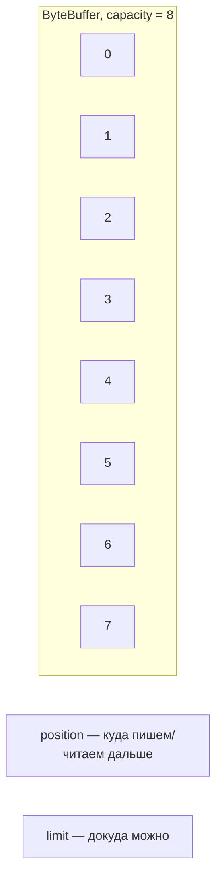

# ByteBuffer

---

## Анатомия



```java
void example() {
    ByteBuffer buffer = ByteBuffer.allocate(8);
    buffer.put((byte) 1).put((byte) 2);
    buffer.flip();                        // -> режим чтения
    while (buffer.hasRemaining()) {
        byte b = buffer.get();
    }
    buffer.clear();                       // -> режим записи
}
```

| Вызов | position | limit | Режим |
|---|---|---|---|
| `allocate(8)` | 0 | 8 | запись |
| `put` × 2 | 2 | 8 | запись |
| `flip()` | 0 | 2 | чтение |
| `get()` × 2 | 2 | 2 | чтение (исчерпан) |
| `clear()` | 0 | 8 | запись |

---

## Три разновидности

| | Где | Создание | Применение |
|---|---|---|---|
| `HeapByteBuffer` | куча JVM, под GC | `ByteBuffer.allocate(n)` | по умолчанию; `Reactor` (этап 6) |
| `DirectByteBuffer` | вне кучи | `ByteBuffer.allocateDirect(n)` | частый/объёмный сетевой I/O — без лишней копии |
| `MappedByteBuffer` | память процесса ↔ файл | `FileChannel.map(...)` | большие файлы, см. ниже |

---

## MappedByteBuffer vs Files

```java
void example() throws IOException {
    byte[] all = Files.readAllBytes(path);               // копия в куче

    try (FileChannel channel = FileChannel.open(path, StandardOpenOption.READ)) {
        MappedByteBuffer mapped = channel.map(
                FileChannel.MapMode.READ_ONLY, 0, channel.size()); // без копии
    }
}
```

**Бенчмарк** (JMH, `MappedFileReadingBenchmark`, `-prof gc`; тестовые данные — синтетический файл
~23 МБ, для занятия заменить на реальный текст, например главу «Войны и мира»):

| Бенчмарк | Время, мкс/операция | Аллокации, Б/операция |
|---|---|---|
| `readAllBytes` | ≈ 11 900 | ≈ 62 500 000 |
| `mappedByteBuffer` (с проходом по байтам) | ≈ 40 300 | ≈ 1 100 |

| | Быстрее по времени | Меньше аллокаций |
|---|---|---|
| `readAllBytes` | ✅ | ❌ |
| `mappedByteBuffer` | ❌ | ✅ (в ~56 000 раз) |

«Меньше аллокаций» ≠ «быстрее» — `MappedByteBuffer` оправдан там, где важна память (большие файлы,
GC-паузы), не сырая скорость одного чтения.
