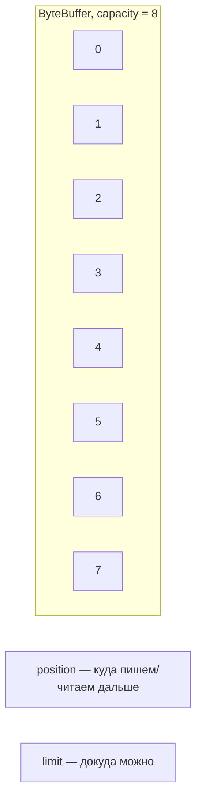

# ByteBuffer: анатомия



```java
void example() {
    ByteBuffer buffer = ByteBuffer.allocate(8);
    buffer.put((byte) 1).put((byte) 2);
    buffer.flip();                        // -> режим чтения
    while (buffer.hasRemaining()) {
        byte b = buffer.get();
    }
    buffer.clear();                       // -> режим записи
}
```

| Вызов | position | limit | Режим |
|---|---|---|---|
| `allocate(8)` | 0 | 8 | запись |
| `put` × 2 | 2 | 8 | запись |
| `flip()` | 0 | 2 | чтение |
| `get()` × 2 | 2 | 2 | чтение (исчерпан) |
| `clear()` | 0 | 8 | запись |
