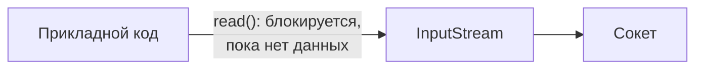
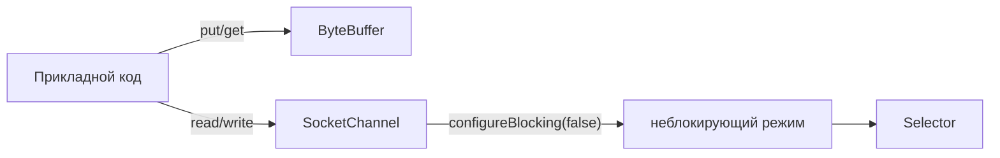

# IO vs NIO

---

## java.io



```java
void example() throws IOException {
    InputStream in = socket.getInputStream();
    byte[] buffer = new byte[1024];
    int read = in.read(buffer); // поток встаёт здесь и ждёт
}
```

---

## java.nio



```java
void example() throws IOException {
    SocketChannel channel = SocketChannel.open();
    channel.configureBlocking(false);
    ByteBuffer buffer = ByteBuffer.allocate(1024);
    int read = channel.read(buffer); // не блокируется — возвращает сразу
}
```

---

## Сравнение

| | `java.io` | `java.nio` |
|---|---|---|
| Единица работы | поток байт | буфер + канал |
| Блокировка | всегда | опционально |
| Поток на соединение | 1 : 1 | 1 : N (через `Selector`) |
| Где используется | `HttpClientTInvestApiClient` (этап 2) | `Reactor` (этап 6) |
| Структура данных | нет | [`ByteBuffer`](ByteBuffer/1.%20Анатомия.md) |
