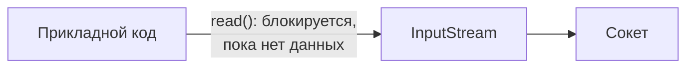

# 1. java.io



```java
void example() throws IOException {
    InputStream in = socket.getInputStream();
    byte[] buffer = new byte[1024];
    int read = in.read(buffer); // поток встаёт здесь и ждёт
}
```

| Класс | Единица данных | Блокировка |
|---|---|---|
| `InputStream`/`OutputStream` | байты | да |
| `Reader`/`Writer` | символы (поверх байтов + кодировка) | да |

Модель thread-per-connection: один поток ОС обслуживает ровно одно соединение целиком, пока оно
открыто — отсюда и масштаб проблемы на [«Путь к Reactor»](../Путь%20к%20Reactor/2.%20Масштаб%20проблемы.md).
