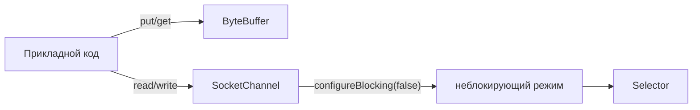

# 2. java.nio



```java
void example() throws IOException {
    SocketChannel channel = SocketChannel.open();
    channel.configureBlocking(false);
    ByteBuffer buffer = ByteBuffer.allocate(1024);
    int read = channel.read(buffer); // не блокируется — возвращает сразу
}
```

`SelectionKey` — что именно канал готов делать прямо сейчас:

| Интерес (`interestOps`) | Когда готов |
|---|---|
| `OP_CONNECT` | TCP-рукопожатие завершено |
| `OP_READ` | есть байты, которые можно прочитать без блокировки |
| `OP_WRITE` | буфер сокета на отправку не заполнен |
| `OP_ACCEPT` | на серверном сокете ждёт новое соединение (в проекте не используется — клиент) |

Канал регистрируется в `Selector` с нужным интересом и переключает его по ходу своего состояния
(см. [«Reactor в сборе»](../Путь%20к%20Reactor/5.%20Reactor%20в%20сборе.md)).
