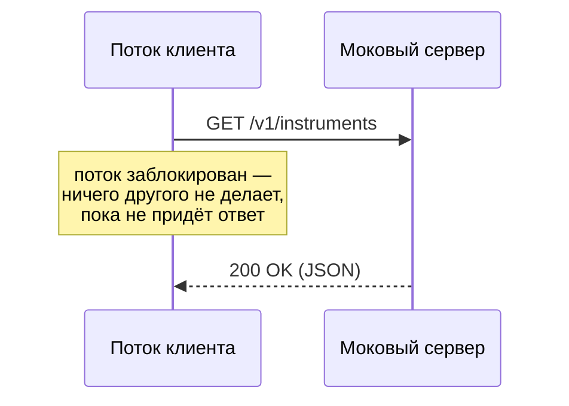
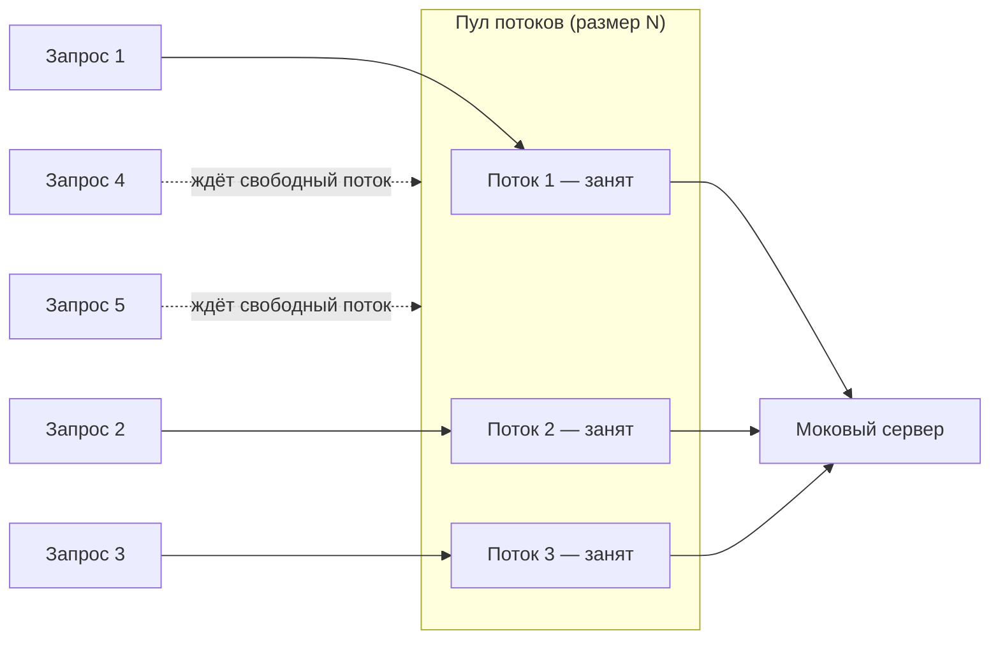
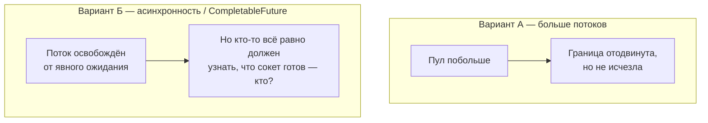
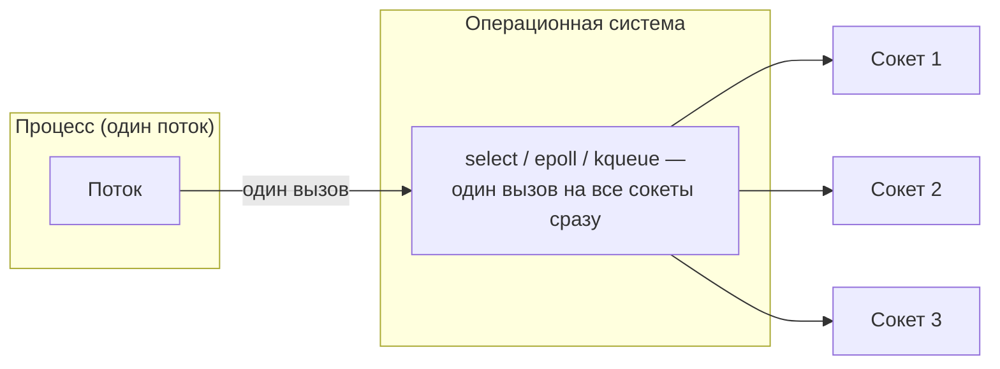
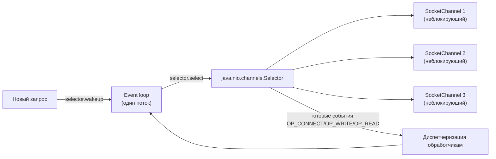

# Продвинутый трек

# Семинар 7. Сетевое взаимодействие (продвинутый трек)

**Тема модуля:** Интеграция с внешним миром

**Тема семинара:** HTTP-клиент к T-Invest API за моковым сервером (Docker); от блокирующего клиента
к Reactor pattern на `Selector` — итеративный разбор, почему и как устроен событийный ввод-вывод, с
живым замером пропускной способности

---

## Формат семинара — сосредоточенный, а не всеохватный

В отличие от черновика предыдущей версии, семинар сконцентрирован **только на сети** — и конкретно
на одном из самых важных и реже всего разбираемых на курсах аспектов: почему и как устроен
неблокирующий ввод-вывод. Это осознанно оставлено на продвинутый трек: к этому моменту студенты уже
пользовались и клиентами, и стримами, и готовы к менее очевидному материалу. Файловая система **не
разбирается на занятии** — см. раздел «Взаимодействие с файловой системой» ниже: она оформлена как
список требований на самостоятельную реализацию, с разбором эталона при необходимости в начале
семинара 8.

Другие HTTP-клиенты (Feign, OkHttp) не обсуждаются содержательно — само их существование
упоминается одной фразой в контексте (этап 1), подробный разбор — тема другого занятия (в базовом
треке они как раз отданы студентам на самостоятельную реализацию).

Центр семинара — Reactor pattern, и он разбирается **от обратного**: сначала группа вживую видит
проблему (блокирующий клиент под нагрузкой), затем совместно ищет решение, и только после этого
получает название и реализацию явления, которое только что придумала сама. Реализация в коде уже
частично заготовлена (5–6 классов) — семинарист либо быстро собирает её вживую, либо показывает
готовую, в зависимости от того, сколько времени осталось после дискуссии: дискуссия важнее того,
кто именно набирает код.

---

## Диаграммы пути к Reactor

Этапы 3–6 — это один связный визуальный рассказ, а не отдельные слайды: одна и та же сцена
(клиент — поток — сокет — сервер) достраивается шаг за шагом, и к прежним шагам не возвращаются
(кроме финального сравнения). Mermaid — чтобы рендерились прямо в GitLab/GitHub без внешних
картинок; при желании семинарист может перерисовать в своём визуальном языке, сохранив ту же
последовательность кадров.

### 1. Блокирующий клиент (этап 3)

### 2. Масштаб проблемы (этап 3, вопрос «а если не пять, а пять тысяч?»)

Опора для вопроса группе, не ответ на него: что произойдёт с этой картинкой при росте числа
запросов?

### 3. Наивные решения и их потолок (этап 4)

### 4. ОС умеет ждать на нескольких сокетах разом (этап 5, первый кадр)

Смена картинки по сравнению с п. 2–3: не поток на сокет, а поток на все сокеты сразу.

### 5. Reactor в сборе (этап 5, финальный кадр → этап 6)

Та же сцена из п. 4, но уже в терминах Java — остальные диаграммы достраивают путь к ней, а не
дублируют её.

> **Для семинариста:** именно на диаграмме 5 впервые уместно произнести термин «Reactor pattern» —
> после того, как группа уже увидела механизм, а не раньше.

---

## Пререквизиты

`Семинар 2 (Proxy, интерфейсы-абстракции над реализацией)` `Семинар 3 (Optional, функциональные интерфейсы)`
`Семинар 4 (собственные исключения, методология JMH)` `Семинар 5 (QuoteService/QuoteSource как явная заглушка
источника)` `Семинар 6 (Stream API — агрегаты stats/movers читают из источника котировок)`
`Docker` `Установленный JDK 25` `Установленный IntelliJ IDEA`

---

## План семинара

| **#** | **Этап**                                                             | **Время** |
|-------|----------------------------------------------------------------------|-----------|
| 1     | Контекст: зачем клиент, какую заглушку меняем                        | ~5 мин    |
| 2     | Показ: `TInvestApiClient` на `HttpClient`                            | ~10 мин   |
| 3     | От обратного: запускаем демо и видим, что поток блокируется          | ~5 мин    |
| 4     | Обсуждение: как избежать блокировки?                                 | ~10 мин   |
| 5     | Путь к Reactor: диаграмма, выстраиваемая по ходу рассказа            | ~15 мин   |
| 6     | Реализация Reactor — изюминка семинара                               | ~20 мин   |
| 7     | Живой замер: пропускная способность блокирующего клиента vs реактора | ~10 мин   |

Итого ~75 мин. Взаимодействие с файловой системой и `MappedByteBuffer` — за пределами этого тайминга,
см. ниже.

---

### Этап 1. Контекст: зачем клиент, какую заглушку меняем (~5 мин)

**Задача, которую решаем.** `QuoteSource` и каталог инструментов — заглушки с захардкоженными
данными, оставленные семинарами 5–6 именно под эту замену. Открыть `QuoteSource` и
`InMemoryInstrumentRepository`, показать комментарии «реальный источник — семинар 7», и от них
оттолкнуться: нужен клиент к `instruments-service` T-Invest API, который можно подставить вместо
заглушки, не трогая остальной код (тот же принцип интерфейса, что и `InstrumentRepository` в
семинаре 2).

> **Для семинариста:** здесь же, одной фразой — кроме `HttpClient` есть и другие способы писать
> HTTP-клиент на JVM (Feign, OkHttp), подробно не разбираем, это материал другого занятия/трека.
> Моковый сервер (Docker) должен быть поднят и проверен заранее — не часть показа, а подготовка до
> семинара.

---

### Этап 2. Показ: `TInvestApiClient` на `HttpClient` (~10 мин)

**Задача, которую решаем.** Настоящий T-Invest API требует токен и недоступен для сотни учебных
запусков одновременно — поднимаем свой HTTP-сервер в Docker, имитирующий ручку
[`instruments-service`](https://developer.tbank.ru/invest/api/instruments-service) (конфигурация
контейнера и expectations — заранее, не на занятии). Базовую реализацию клиента на `HttpClient`
готовит сам семинарист — показ, а не построчный разбор: `HttpClient` создаётся один раз (DI, тот же
принцип, что уже видели с `QuoteService` как одиночным экземпляром в `Main`), запрос/ответ, разбор
JSON в доменные `Instrument`, сетевые сбои оборачиваются в собственное исключение (связка с
семинаром 4).

> **Для семинариста:** эта реализация — то, что в следующем этапе будет демонстрировать проблему
> блокировки. Удобный момент мельком показать переключение поведения мокового сервера через
> заголовок запроса (`X-Mock-Scenario: error`/`timeout`/`ok`), не задерживаясь на этом.

---

### Этап 3. От обратного: запускаем демо и видим, что поток блокируется (~5 мин)

**Задача, которую решаем.** Вместо того чтобы сразу назвать и объяснить Reactor pattern, сначала
показываем проблему, которую он решает, — вживую.

Запускаем клиента с этапа 2 под несколькими одновременными запросами (поток/небольшой пул потоков,
без затей) и смотрим на то, что происходит: каждый запрос занимает поток на всё время ожидания
ответа мокового сервера. При достаточном числе одновременных запросов часть из них просто ждёт
своей очереди на свободный поток — демонстрируется либо через дебаггер/thread dump, либо через
простой лог с меткой времени начала/конца обработки на поток.

> **Вопрос группе.** Что здесь плохо, если представить, что одновременных запросов не пять, а пять
> тысяч? Подвести к выводу: поток — дорогой ресурс, и он всё это время ничего не делает, кроме
> ожидания.

---

### Этап 4. Обсуждение: как избежать блокировки? (~10 мин)

Открытый вопрос группе, без предложенных вариантов заранее: как сделать так, чтобы один запрос не
занимал поток на всё время ожидания ответа?

Ожидаемые/наводимые варианты и их разбор прямо в моменте:

- **Больше потоков** (пул побольше) — не решает проблему принципиально, просто отодвигает границу;
  при пяти тысячах одновременных запросов пять тысяч потоков уже сами по себе дорогое удовольствие
  (память на стек каждого, переключение контекста).
- **Асинхронность / `CompletableFuture`** — ближе к сути (поток не блокируется на явном ожидании),
  но не отвечает на вопрос, что физически происходит с ожиданием ответа от сокета, пока асинхронная
  операция «в процессе».

> **Для семинариста:** цель этапа — не закрыть вопрос полностью, а подвести группу к следующему
> шагу: если не создавать потоки под каждое ожидание, то нужен способ одному потоку следить сразу за
> многими сокетами одновременно — и такой способ есть на уровне операционной системы.

---

### Этап 5. Путь к Reactor: диаграмма, выстраиваемая по ходу рассказа (~15 мин)

**Задача, которую решаем.** Современные ОС дают процедуры, которые позволяют одному потоку
отслеживать сразу несколько сокетов и узнавать, какие из них готовы к чтению/записи, не блокируясь
на каждом по отдельности (`select`/`poll`/`epoll`/`kqueue` в зависимости от ОС; в Java —
`java.nio.channels.Selector` как кроссплатформенная абстракция над ними).

Диаграмма строится по ходу рассказа, а не показывается готовой целиком с самого начала — так
проблема и решение связываются напрямую, а не воспринимаются как две отдельные темы:

1. Один `Selector`, несколько зарегистрированных `SocketChannel` в неблокирующем режиме.
2. `select()` блокирует поток ровно до момента, пока хотя бы один канал не станет готов — но это
   один поток на все соединения разом, а не один на каждое.
3. Новый запрос не ждёт своей очереди на `select()` — добавление нового канала в отслеживание
   прерывает текущий `select()` через `selector.wakeup()`, канал регистрируется, цикл продолжается.
4. Цена: асинхронный код сложнее читать и отлаживать, граничные случаи non-blocking I/O (частичная
   запись, EOF посреди чтения) требуют аккуратности, не нужной при блокирующем API.

> **Для семинариста:** диаграммы 4–5 из раздела «Диаграммы пути к Reactor» (выше) — показывать по
> ходу этого рассказа, кадр за кадром, не раньше.

---

### Этап 6. Реализация Reactor — изюминка семинара (~20 мин)

В коде заготовлены классы (5–6 штук: селектор-луп, регистрация канала, обработчик готовности,
обёртка над клиентским интерфейсом с этапа 2) — в зависимости от того, сколько времени осталось
после этапов 3–5, семинарист либо быстро собирает их вживую (без долгих объяснений — это уже
сделано на этапе 5), либо показывает готовую реализацию. Оба варианта держать наготове, решение —
по ходу занятия.

> **Для семинариста:** реализация подключается за тем же интерфейсом клиента, что и `HttpClient`-
> версия с этапа 2 — простой утильный класс-переключатель (не полноценный feature-flagging
> фреймворк) выбирает, какая используется, по конфигу/аргументу. Это не отдельный по времени этап, а
> деталь текущего — не задерживаться на нём отдельно.

---

### Этап 7. Живой замер: пропускная способность блокирующего клиента vs реактора (~10 мин)

Единственный живой прогон за весь семинар, где это оправдано: блокирующий клиент vs реактор под
растущим числом одновременных запросов к моковому серверу. Меняющиеся на глазах цифры нагляднее
любого слайда с готовым результатом.

Ожидаемая картина: на малом числе запросов разница не видна или блокирующий даже быстрее (меньше
накладных на событийный цикл); с ростом числа одновременных запросов блокирующий клиент упирается в
размер пула потоков, реактор продолжает масштабироваться.

> **Для семинариста:** прогнать заранее хотя бы раз на том же железе/контейнере, с которым пойдёте
> на занятие — не ради точных цифр (они и не нужны, важно соотношение), а чтобы не столкнуться
> вживую с тем, что мок не держит нужную нагрузку или замер идёт дольше, чем остаток тайминга этапа.
> Держать под рукой и готовый прогон на случай, если на занятии что-то пойдёт не так с окружением.

> **Вопрос группе.** Если реактор не создаёт дополнительных потоков, то за счёт чего растёт
> пропускная способность? Подвести к ответу: не за счёт параллелизма исполнения, а за счёт того,
> что поток перестаёт простаивать — I/O-ожидание больше не блокирует ничего, кроме самого
> ожидающего запроса.

---

### Итоги

За сегодня: заглушка `QuoteSource`/каталога уступила место настоящему клиенту к внешнему API за
интерфейсом; от проблемы (блокирующий поток на запрос) группа сама пришла к идее, которая на практике
называется Reactor pattern, увидела её реализацию и подтвердила разницу живым замером.

Следующий семинар — рефакторинг и тестирование; если потребуется, первые 15–20 минут уйдут на разбор
эталонной реализации файловой системы (см. ниже) для тех, кто не успел/не справился самостоятельно.

---

## Взаимодействие с файловой системой — вне тайминга этого семинара

Данные, полученные по сети, нужно где-то хранить между запусками — текущий репозиторий теряет всё
при перезапуске процесса. Сознательное решение: не разбирать это на занятии, а оформить как
самостоятельную работу — не только списком требований, но и кодом для старта: контракт
(`persistence/QuoteFileStore.java`), заготовка без решения
(`persistence/QuoteFileStoreSkeleton.java`, методы бросают `UnsupportedOperationException("TODO: ...")`)
и тест для самопроверки (`persistence/QuoteFileStoreContractTest.java`, абстрактный — скопировать и
подставить свою реализацию в `createStore()`). См.
[«Требования к файловому хранилищу»](Требования%20к%20файловому%20хранилищу.md) за полным
контрактом.

Вокруг контракта уже готово и не часть самостоятельной работы:

- Команда `update` — через клиент (этапы 2/6) забирает актуальные данные, формирует новый файл с
  обновлёнными значениями.
- `WatchService` отслеживает появление новых файлов в каталоге и инвалидирует кеш репозитория — не
  пере-читывает с диска на каждый запрос, а только когда файл реально обновился.
- Репозиторий читает с диска по запросу и кеширует прочитанное — повод вернуться к кеширующему Proxy
  на `LinkedHashMap`, который на семинаре 5 (этап 3.4) был чистой демонстрацией паттерна: здесь он
  перестаёт быть демонстрацией и становится реальным механизмом.

Может быть сделано на том же занятии (если после этапа 7 остаётся время) или как домашнее задание,
возможно с дополнительными баллами. Эталонная реализация (`persistence/QuoteFileStoreReference.java`)
— для разбора в начале семинара 8 при необходимости (15–20 мин), без претензии на то, что она
единственно верная; студентам заранее не показывать.

---

## Персистентность за рамками тайминга занятия

Три куска уже реализованы в коде (не часть программы занятия — ссылаться по необходимости), чтобы
проект был целостным независимо от того, когда студенты доделают файловое хранилище котировок:

- **Watchlist на диске** (`persistence/WatchlistStore.java`,
  `persistence/WatchlistStoreReference.java`) — какие тикеры отслеживает пользователь, в формате
  JSON; `watch` сохраняет сразу при добавлении тикера, `Main` читает watchlist при старте.
- **История цен** (`history/PriceHistoryStore.java`, `history/PriceHistoryStoreReference.java`) —
  материал для будущей статистики: каждый вызов `update` пишет по инструменту одну точку
  (тикер, момент времени, цена) в **новый** бинарный файл (`DataOutputStream`/`DataInputStream`,
  без разделителей) — в отличие от `QuoteFileStore`, который перезаписывает один и тот же файл,
  здесь каждое сохранение — отдельный неизменяемый файл.
- **Аудит пользовательских действий** (`audit/UserAction.java`, `audit/UserActionLog.java`) —
  партиционированный по дате лог (`logs/actions-YYYY-MM-DD.log`), запись всегда в конец файла.
  Сейчас пишутся события `INSTRUMENT_ADDED` (`add`), `WATCH_ADDED` (`watch`), `QUOTES_UPDATED`
  (`update`). Типы `BOUGHT`/`SOLD` заведены заранее, хотя команды покупки/продажи в CLI ещё нет —
  формат лога не придётся менять задним числом, когда она появится.

---

## MappedByteBuffer vs Files — демо сравнения, вне тайминга этого семинара

Отдельно, после или вместо занятия (на усмотрение по времени — семинар или самообразование): показ,
когда обычное чтение (`Files.readAllBytes`/`readAllLines`) перестаёт быть адекватным вариантом, и как
`MappedByteBuffer` отображает файл в память процесса вместо копирования содержимого в кучу.

**Бенчмарк (JMH, `-prof gc` для памяти).** Тестовые данные — конкретный, узнаваемый большой текстовый
файл, а не синтетическая заглушка: одна глава «Войны и мира» (общественное достояние — нужно
подготовить сам файл заранее, здесь нет доступа в сеть, чтобы его скачать). Сравниваются:

- `Files.readAllBytes(path)` — весь файл копируется в один `byte[]` в куче.
- `FileChannel.map(MapMode.READ_ONLY, 0, size)` — файл отображается в память процесса через
  `MappedByteBuffer`, копирования в кучу нет.

Два замера на тот же бенчмарк: обычный `avgt` (время) и `-prof gc` (аллокации на операцию) — именно
второй показывает разницу, ради которой это всё затевается.

**Фактический прогон** (`MappedFileReadingBenchmark`, синтетический файл ~23 МБ — для занятия
заменить на настоящий текст, см. выше):

| Бенчмарк                                | Время, мкс/операция | Аллокации, Б/операция |
|------------------------------------------|----------------------|------------------------|
| `readAllBytes`                           | ≈ 11 900             | ≈ 62 500 000           |
| `mappedByteBuffer` (с проходом по байтам) | ≈ 40 300             | ≈ 1 100                |

Картина ровно подтверждает тезис этапа, но не так, как можно было бы ожидать: по **времени**
`mappedByteBuffer` в этом прогоне медленнее (побайтовый проход по `MappedByteBuffer.get()` дороже
одного объёмного копирования памяти, которое делает `readAllBytes`) — зато по **аллокациям в куче**
разница на четыре с лишним порядка (`readAllBytes` выделяет объём, сравнимый с размером файла, на
каждый вызов; `MappedByteBuffer` — почти ничего, страницы обслуживает кеш страниц ОС). Хороший повод
явно проговорить: «меньше аллокаций» и «быстрее по времени» — не одно и то же, и `MappedByteBuffer`
оправдан именно там, где важна память (большие файлы, GC-паузы), а не сырая скорость одного чтения.

---

### Исходный код

Файлы итогового кода: `client/TInvestApiClient.java`, `client/TInvestApiProperties.java`,
`client/InstrumentQuoteDto.java`, `client/InstrumentQuoteMapper.java`, `client/TInvestApiException.java`,
`client/HttpClientTInvestApiClient.java`, `client/TInvestClientMode.java`,
`client/reactor/Reactor.java`, `client/reactor/PendingExchange.java`,
`client/reactor/RawHttpProtocol.java`, `client/reactor/ReactorTInvestApiClient.java`,
`cli/AddCommand.java`, `cli/WatchCommand.java`, `cli/UpdateCommand.java`,
`demo/TInvestApiClientDemo.java`, `demo/BlockingClientDemo.java`, `demo/MappedByteBufferDemo.java`,
`benchmark/ClientThroughputBenchmark.java`, `benchmark/MappedFileReadingBenchmark.java`,
`persistence/QuoteFileStore.java`, `persistence/QuoteFileStoreReference.java`,
`persistence/FileBackedQuoteRepository.java`, `persistence/QuoteFileWatcher.java`,
`persistence/WatchlistStore.java`, `persistence/WatchlistStoreReference.java`,
`history/PriceHistoryStore.java`, `history/PriceHistoryStoreReference.java`, `history/PricePoint.java`,
`audit/UserAction.java`, `audit/UserActionLog.java`, `demo/Main.java`.

Для самостоятельной работы (не показывать студентам заранее): `persistence/QuoteFileStoreSkeleton.java`
(заготовка с `TODO`), `persistence/QuoteFileStoreReference.java` (эталон). См. также
[«Требования к файловому хранилищу»](Требования%20к%20файловому%20хранилищу.md).

> **Проверено:** `TInvestApiClientContractTestBase` (JUnit, встроенный `com.sun.net.httpserver.HttpServer`
> вместо Docker) гоняет один и тот же контракт на `HttpClientTInvestApiClient` и
> `ReactorTInvestApiClient` — 6/6 зелёных, включая сам `Reactor` целиком (connect/write/read через
> `Selector`). `QuoteFileStoreReferenceTest`, `WatchlistStoreReferenceTest`,
> `PriceHistoryStoreReferenceTest`, `UserActionLogTest` — ещё 7/7 (итого 13/13).
> `ClientThroughputBenchmark` требует живого мокового сервера (Docker) — не прогонялся в среде
> подготовки (демон оказался нестабилен), прогнать перед занятием. `MappedFileReadingBenchmark`
> прогнан и даёт цифры выше.

---

## Навыки, полученные на семинаре

`HttpClient: клиент как одиночный переиспользуемый экземпляр` `Блокирующий I/O и его цена`
`Selector и неблокирующий ввод-вывод` `select()/wakeup()` `Reactor pattern: от проблемы к архитектуре`
`Feature-flag как переключатель реализации` `JMH: пропускная способность под нагрузкой`
`Бинарный файл: DataOutputStream/DataInputStream` `Партиционированный по дате лог`
`WatchService: отслеживание изменений файловой системы (самостоятельная работа)`
`MappedByteBuffer для больших файлов` `JMH -prof gc: сравнение аллокаций в куче`
