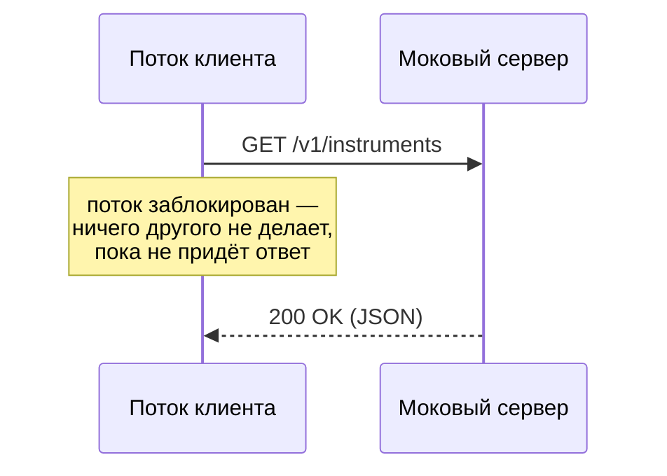
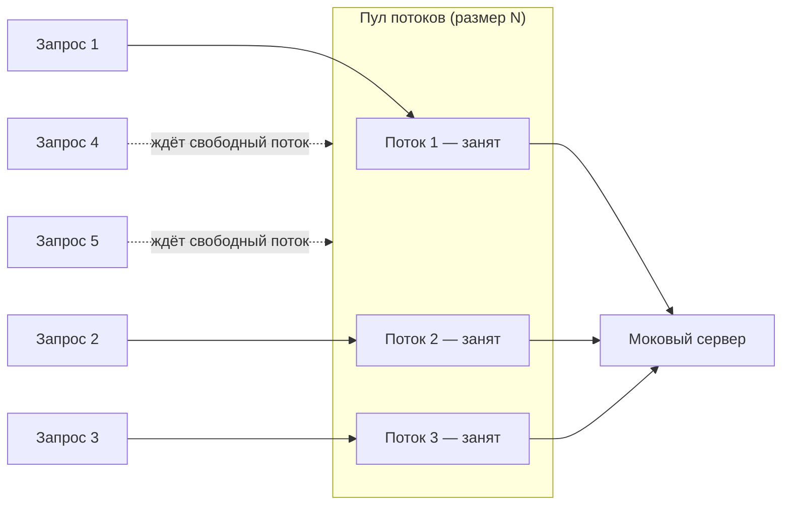
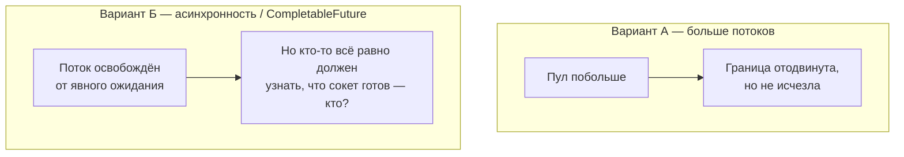
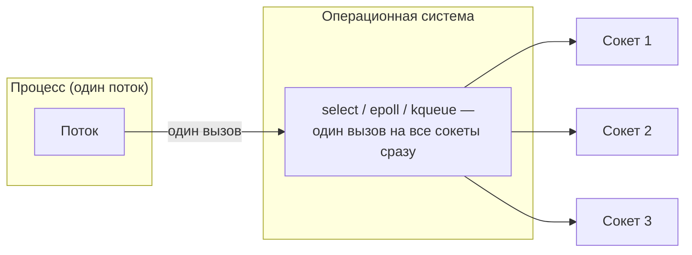
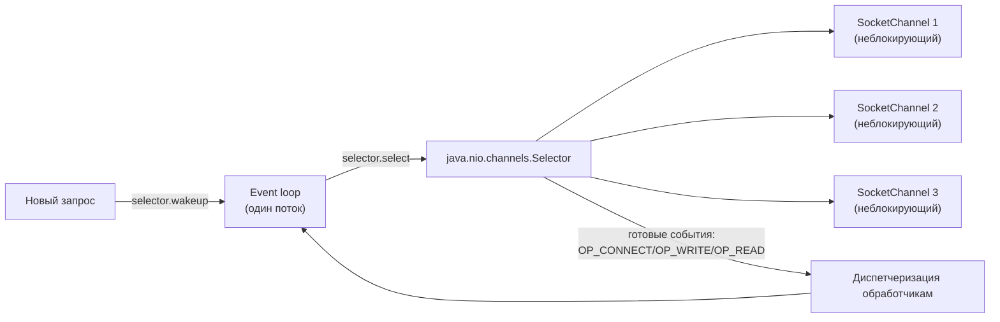

# Путь к Reactor (диаграммы)

---

## 1. Блокирующий клиент

## 2. Масштаб проблемы

---

## 3. Наивные решения и их потолок

---

## 4. ОС умеет ждать на нескольких сокетах разом

---

## 5. Reactor в сборе

| Кадр | Что нового |
|---|---|
| 1 | Один поток, один запрос, заблокирован |
| 2 | N потоков, запросы сверх N — в очереди |
| 3 | Больше потоков / async — потолок или нерешённый вопрос |
| 4 | ОС: один вызов, много сокетов |
| 5 | То же самое в терминах Java: `Selector` + неблокирующие `SocketChannel` |
