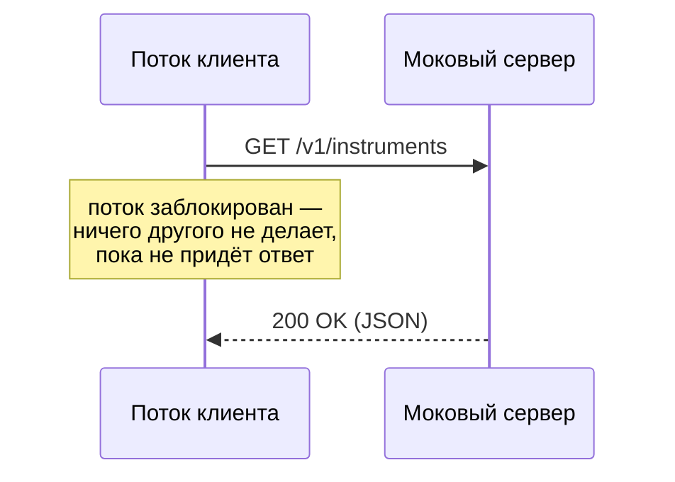

# 1. Блокирующий клиент

| Фаза | Что делает поток | CPU |
|---|---|---|
| Отправка запроса | работает (сборка байт, write) | занят |
| Ожидание ответа | ничего — спит в `read()` | простаивает |
| Разбор ответа | работает (парсинг JSON) | занят |

Большую часть времени запроса поток **ждёт**, а не вычисляет — и всё равно занят целиком.
