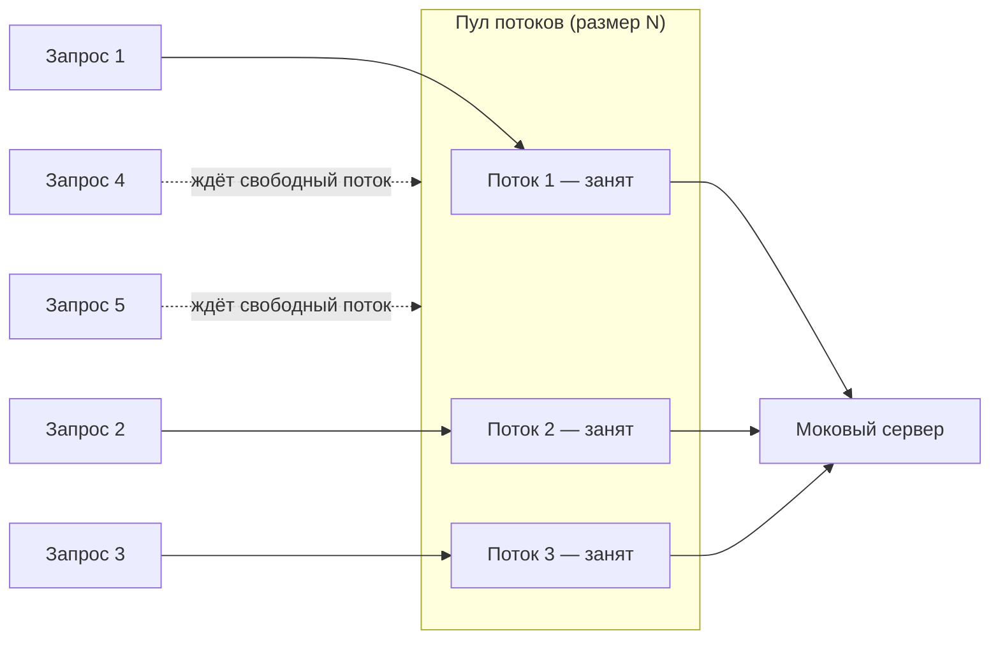

# 2. Масштаб проблемы

Поток ОС — не бесплатный ресурс: стек по умолчанию ~512 КБ–1 МБ (`-Xss`), плюс цена переключения
контекста растёт с числом потоков.

| Одновременных соединений | Потоков | Память только на стеки |
|---|---|---|
| 100 | 100 | ≈ 100 МБ |
| 1 000 | 1 000 | ≈ 1 ГБ |
| 10 000 | 10 000 | ≈ 10 ГБ |

Это и есть классическая проблема **C10K** (10 000 одновременных соединений) — модель «поток на
соединение» упирается в память и в планировщик ОС задолго до того, как упрётся реальная полоса
пропускания сети.
