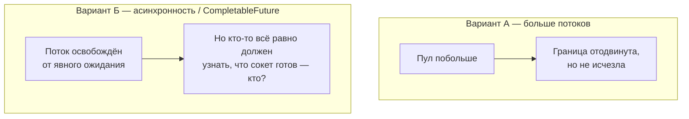

# 3. Наивные решения и их потолок



```java
void example() {
    CompletableFuture.supplyAsync(client::fetchQuotes) // поток пула вызывает БЛОКИРУЮЩИЙ fetchQuotes
            .thenAccept(System.out::println);
    // вызывающий код не ждёт — но внутри supplyAsync поток пула всё равно блокируется на I/O
}
```

| | Больше потоков | `CompletableFuture` без Reactor |
|---|---|---|
| Что решает | ничего принципиально | освобождает вызывающий поток |
| Что не решает | память/планировщик на масштабе | поток **внутри** `supplyAsync` всё равно блокируется |
| Вывод | та же проблема, другой порог | нужен способ ждать I/O **без выделенного потока на каждое ожидание** |
