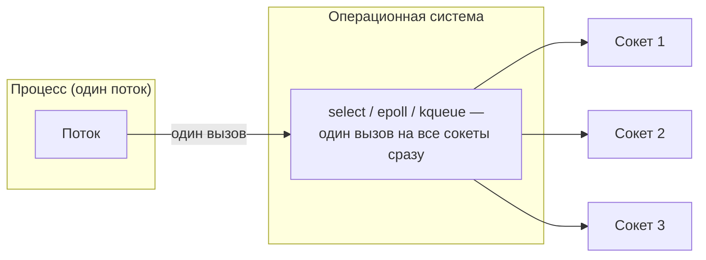

# 4. ОС умеет ждать на нескольких сокетах разом

| Механизм | ОС | Сложность на N сокетов | Лимит |
|---|---|---|---|
| `select` | POSIX (везде) | O(N) — ядро сканирует все | обычно 1024 (`FD_SETSIZE`) |
| `poll` | POSIX | O(N) | без жёсткого лимита |
| `epoll` | Linux | O(1) — ядро само ведёт список готовых | без лимита |
| `kqueue` | BSD, macOS | O(1), аналог `epoll` | без лимита |

`java.nio.channels.Selector` — кроссплатформенная абстракция поверх всего этого: `SelectorProvider`
на старте JVM сам выбирает подходящий механизм под текущую ОС, прикладной код об этом не знает.
