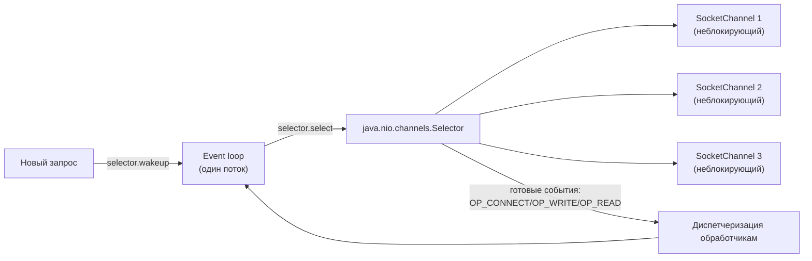
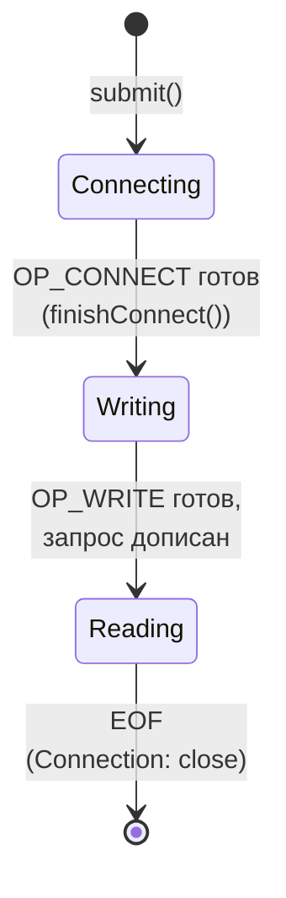

# 5. Reactor в сборе

Состояние одного запроса (`PendingExchange`) в нашей реализации — ровно три шага:

| Этап | Что ждём | Что делаем |
|---|---|---|
| `Connecting` | `OP_CONNECT` | `finishConnect()`, переключаем интерес на `OP_WRITE` |
| `Writing` | `OP_WRITE` | дописываем `ByteBuffer` запроса, переключаем на `OP_READ` |
| `Reading` | `OP_READ` | копим байты до EOF, завершаем `CompletableFuture` |

| Кадр | Что нового |
|---|---|
| 1 | Один поток, один запрос, заблокирован |
| 2 | N потоков, запросы сверх N — в очереди (C10K) |
| 3 | Больше потоков / async — потолок или нерешённый вопрос |
| 4 | ОС: один вызов, много сокетов (`select`/`epoll`/`kqueue`) |
| 5 | То же самое в терминах Java: `Selector` + неблокирующие `SocketChannel` |
