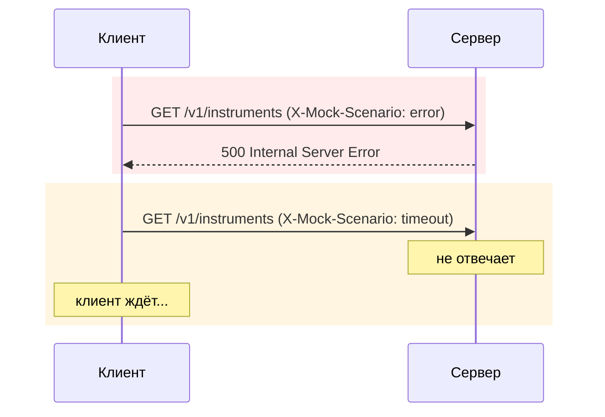
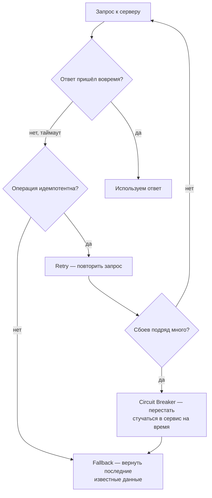

# Что делать, если сервер сбоит

---

## Два сценария

| Клиент | Реагирует на error/timeout? |
|---|---|
| `HttpClientTInvestApiClient` (блокирующий) | нет |
| `ReactorTInvestApiClient` (неблокирующий) | нет — другая проблема решена, не эта |

---

## Что обычно с этим делают

| Паттерн | Коротко |
|---|---|
| **Timeout** | не ждать ответ вечно |
| **Retry** | повторить при сбое — только для идемпотентных операций |
| **Circuit Breaker** | после серии сбоев перестать стучаться на время |
| **Fallback** | вернуть последние известные данные вместо ошибки |

---

## Сегодня / потом

| Сегодня | Потом |
|---|---|
| Увидели, что проблема есть | Реализация `Retry`/`Circuit Breaker`/... |
