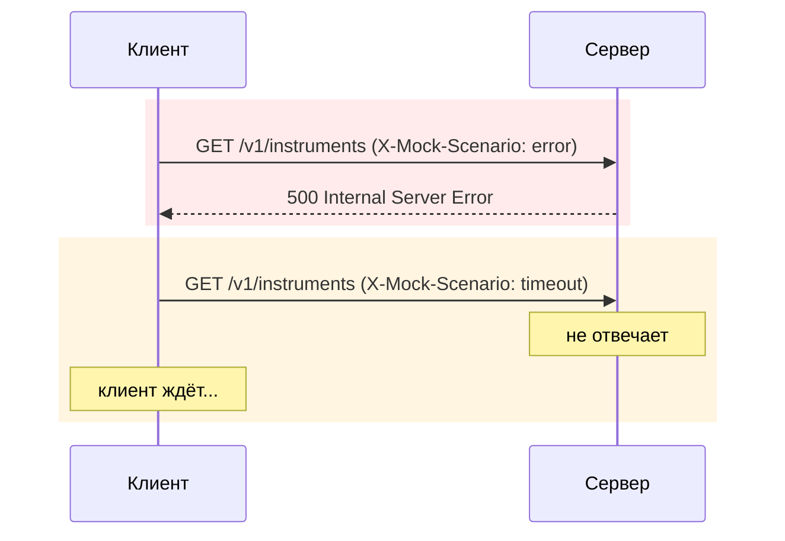

# 1. Два сценария

| Клиент | Реагирует на error/timeout? |
|---|---|
| `HttpClientTInvestApiClient` (блокирующий) | нет |
| `ReactorTInvestApiClient` (неблокирующий) | нет — другая проблема решена, не эта |

Неблокирующий ввод-вывод избавляет от простаивающего потока (см. [«Путь к Reactor»](../Путь%20к%20Reactor/)),
но ничего не говорит про то, что делать, когда ответа нет вовсе или он говорит «ошибка».
