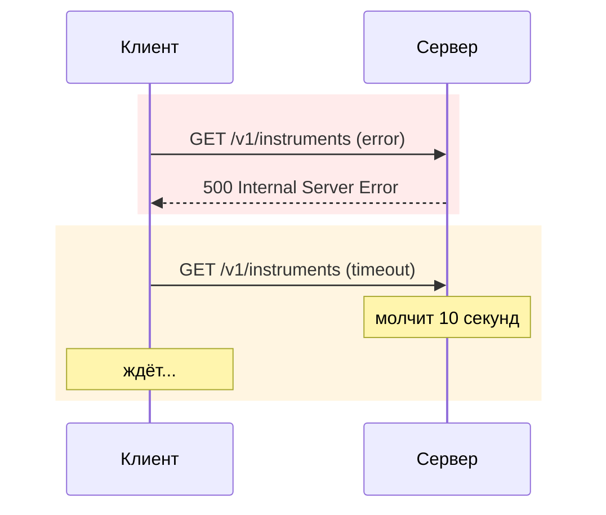

# 1. Два сценария сбоя

Моковый сервер переключается заголовком `X-Mock-Scenario`:

```
curl -i -H "X-Mock-Scenario: error"   http://localhost:1080/v1/instruments   # -> 500
curl -i -H "X-Mock-Scenario: timeout" http://localhost:1080/v1/instruments   # -> ответ через 10 секунд
```



| Сбой | Как выглядит для клиента | Чем опасен |
|---|---|---|
| Ошибка (`5xx`) | ответ пришёл быстро, но «плохой» | при повторах нагружает и без того больной сервис |
| Таймаут | ответа нет совсем | блокирует поток (или держит `future`) на всё время ожидания |
| Обрыв соединения | `IOException` посреди обмена | неизвестно, дошёл ли запрос и выполнился ли он |
| Мусор в ответе | `200`, но JSON битый | ошибка разбора, а не сети — ретраить бесполезно |

Важная оговорка про демо: наши Java-клиенты **не отправляют** `X-Mock-Scenario`, поэтому режимы
ошибки/таймаута включаются только вручную (`curl`) — это показ поведения сервера. Как ведут себя
клиенты — на следующем слайде.
