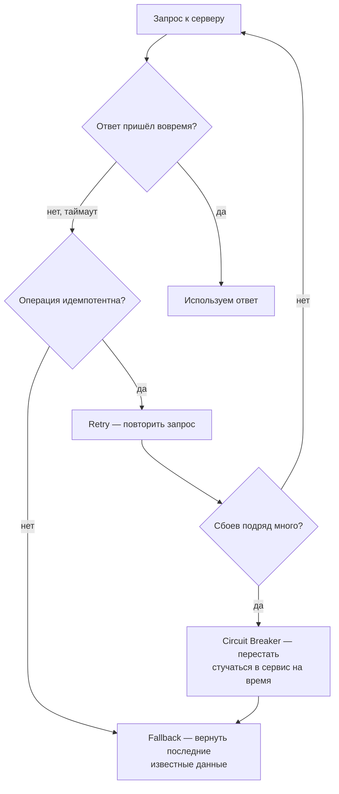

# 2. Паттерны

| Паттерн | Коротко | Типичная реализация в Java |
|---|---|---|
| **Timeout** | не ждать ответ вечно | `HttpClient`/`Socket` таймауты, см. `TInvestApiProperties` |
| **Retry** | повторить при сбое — только для идемпотентных операций | Resilience4j `Retry`, Spring `@Retryable` |
| **Circuit Breaker** | после серии сбоев перестать стучаться на время | Resilience4j `CircuitBreaker`, Hystrix (устарел) |
| **Bulkhead** | ограничить число параллельных вызовов к одному сервису — сбой одного не кладёт всё | Resilience4j `Bulkhead`, отдельный пул потоков/семафор |
| **Fallback** | вернуть последние известные данные вместо ошибки | свой код: кеш/дефолт на catch |

`Bulkhead` — по аналогии с переборками корабля: если один участок кода (вызов к одному сервису)
тонет, остальные части приложения не тонут вместе с ним — у каждого вызова свой ограниченный
бюджет потоков/запросов.
