# Семинар 7. Отчёт о ручном запуске HTTP-клиентов

Дата: 26 октября 2026 года.

Приложение запущено с тремя реализациями `TInvestApiClient`: Java HttpClient,
Feign и OkHttp. Для каждой выполнены три запуска: без сценария, с ошибкой сервера
(`error`) и с задержкой ответа (`timeout`). Всего — 9 запусков.


## Подготовка и порядок запуска
1. Создана конфигурация Application:
   - Main class: `academy.backend.market_pulse.demo.Main`;
   - Classpath module: `basic`;
   - JRE: Java 25;
   - Working directory: корень проекта (в выполненных запусках —
     `/Users/arturaipov/Desktop/market-pulse-innopolis`).
2. Для всех девяти запусков использованы аргументы программы `update`, без тикера.
3. Клиент переключался в [AppConfig.java](../../../src/main/java/academy/backend/market_pulse/config/AppConfig.java):
   ```java
   this.apiClient = new HttpClientTInvestApiClient(properties);
   this.apiClient = new FeignTInvestApiClientReference(properties);
   this.apiClient = new OkHttpTInvestApiClientReference(properties);
   ```
   
Использованы три конфигурации запуска:

| Конфигурация | Аргументы программы | Переменная окружения |
|---|---|---|
| `UPDATE` | `update` | `MARKET_PULSE_MOCK_SCENARIO` не задана |
| `UPDATE_ERROR` | `update` | `MARKET_PULSE_MOCK_SCENARIO=error` |
| `UPDATE_TIMEOUT` | `update` | `MARKET_PULSE_MOCK_SCENARIO=timeout` |


## Результаты

| Клиент | Режим | Наблюдаемый результат | Код завершения |
|---|---|---|---|
| HttpClient | Без сценария | HTTP 200; одна котировка сохранена в `data/quotes.txt` | 0 |
| HttpClient | `error` | HTTP 500; сообщение о неожиданном статусе | 1 |
| HttpClient | `timeout` | Через 5 секунд `request timed out`, затем сообщение об ошибке запроса | 1 |
| Feign | Без сценария | Одна котировка сохранена в `data/quotes.txt` | 0 |
| Feign | `error` | Сообщение об ошибке сервера: 500 | 1 |
| Feign | `timeout` | Сообщение о невозможности выполнить запрос | 1 |
| OkHttp | Без сценария | Одна котировка сохранена в `data/quotes.txt` | 0 |
| OkHttp | `error` | Сообщение о неожиданном статусе: 500 | 1 |
| OkHttp | `timeout` | Сообщение о невозможности выполнить запрос | 1 |

При обычном ответе сервера все три клиента обновили одну котировку. При ошибке
500 и задержке ответа приложение вывело сообщение об ошибке и завершилось
с кодом 1. Для сценариев сбоев такой код завершения — ожидаемый результат.

## Скриншоты настройки

### Добавление SBER в watchlist

Аргументы программы — `watch SBER`, рабочая директория — корень проекта.

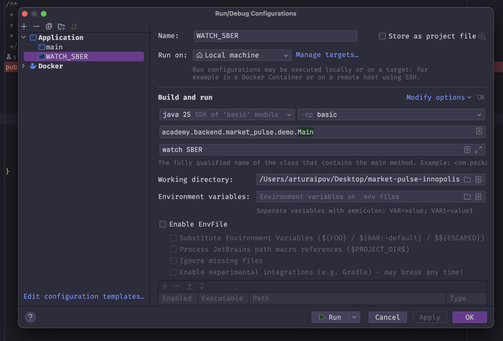

### Сценарий error

Аргументы программы — `update`, переменная окружения —
`MARKET_PULSE_MOCK_SCENARIO=error`.

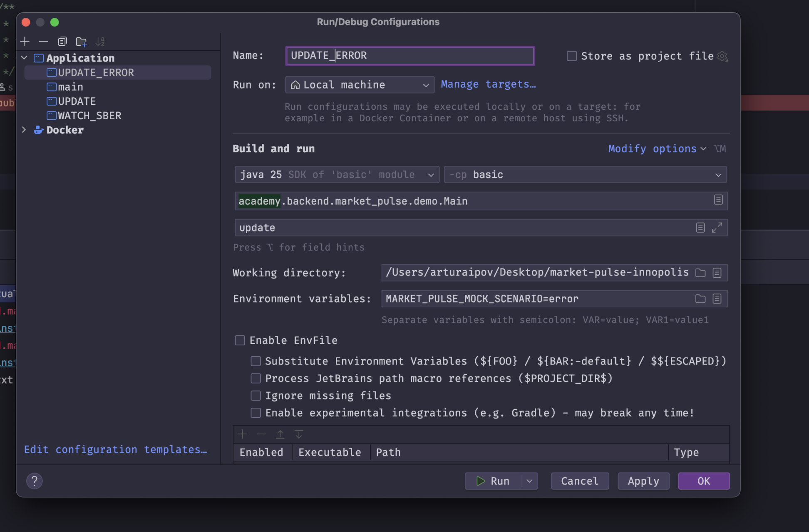

### Сценарий timeout

Аргументы программы — `update`, переменная окружения —
`MARKET_PULSE_MOCK_SCENARIO=timeout`.

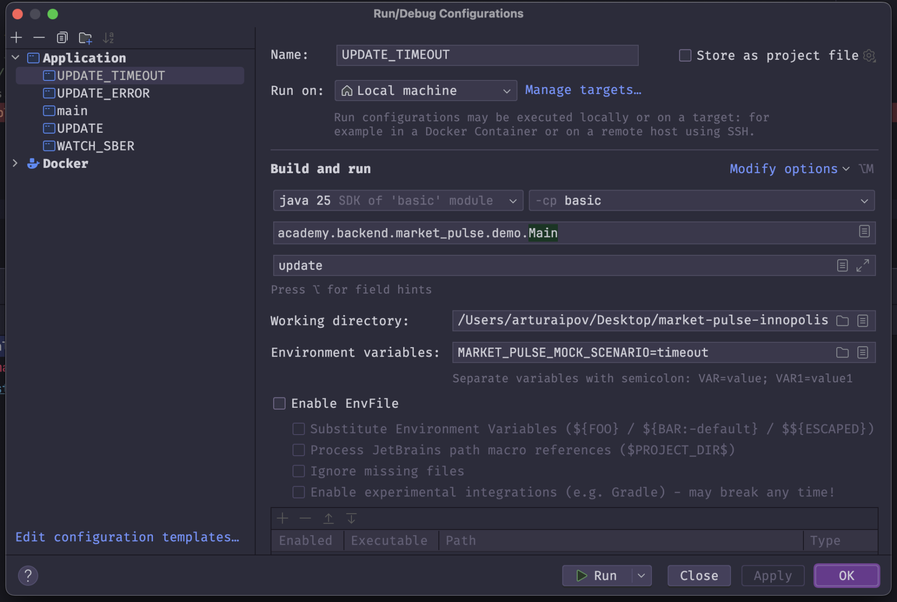

## Скриншоты результатов запусков

### HttpClient: без сценария

HTTP 200, сохранена одна котировка, код завершения 0.

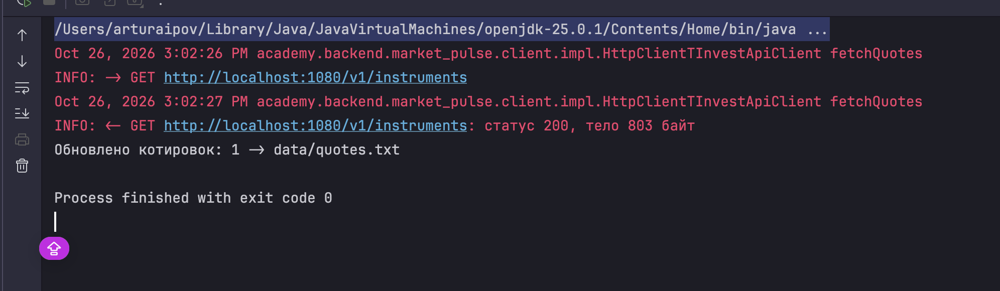

### HttpClient: error

HTTP 500, сообщение «instruments-service вернул неожиданный статус: 500»,
код завершения 1.

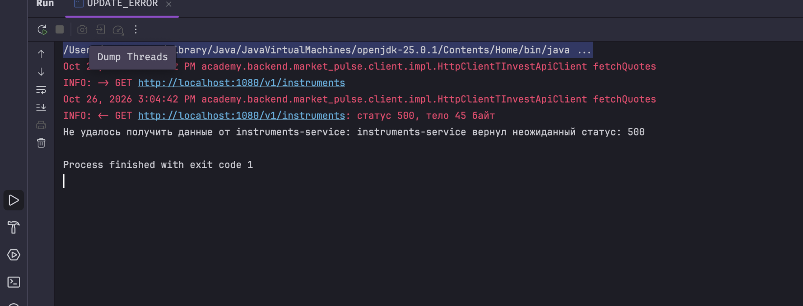

### HttpClient: timeout

Через 5 секунд в логе появилось `request timed out`, затем сообщение
«Не удалось выполнить запрос к instruments-service». Код завершения 1.

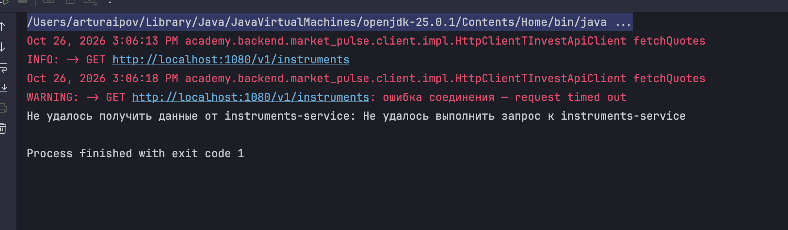

### Feign: без сценария

Сохранена одна котировка, код завершения 0.

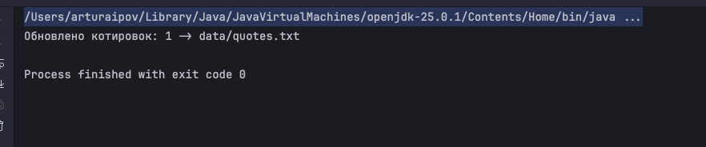

### Feign: error

Сообщение «instruments-service вернул ошибку: 500», код завершения 1.

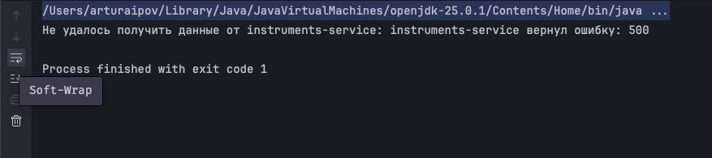

### Feign: timeout

Сообщение «Не удалось выполнить запрос к instruments-service», код завершения 1.

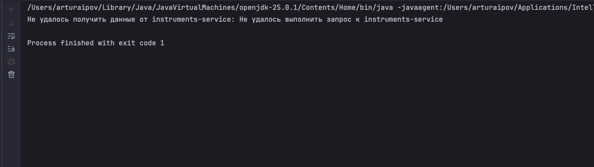

### OkHttp: без сценария

Сохранена одна котировка, код завершения 0.

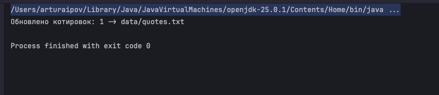

### OkHttp: error

Сообщение «instruments-service вернул неожиданный статус: 500», код завершения 1.

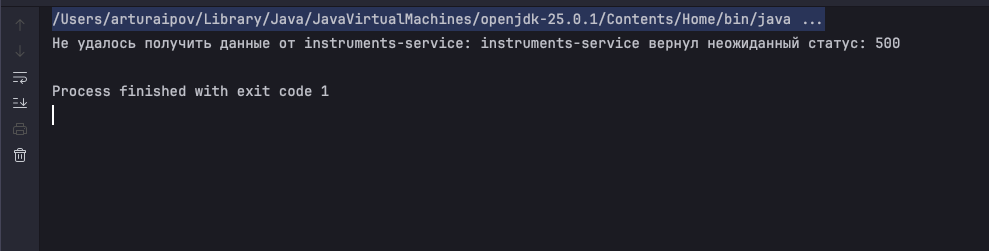

### OkHttp: timeout

Сообщение «Не удалось выполнить запрос к instruments-service», код завершения 1.

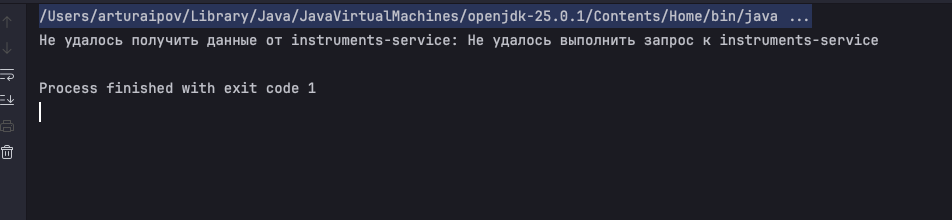

## Ошибка аргументов при первоначальной настройке

Этот запуск не входит в девять сценариев выше. Первоначально были указаны
аргументы `update SBER`. Команда `update` не принимает тикер: она обновляет
все отслеживаемые инструменты из watchlist.

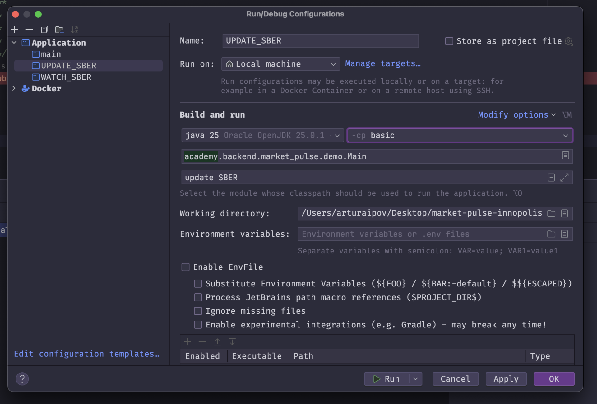

Приложение вывело `Unmatched argument at index 1: 'SBER'` и завершилось с кодом 2.
После замены аргументов на `update` обычный запуск прошёл успешно.

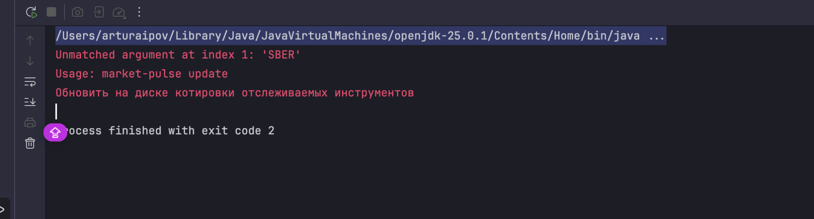
