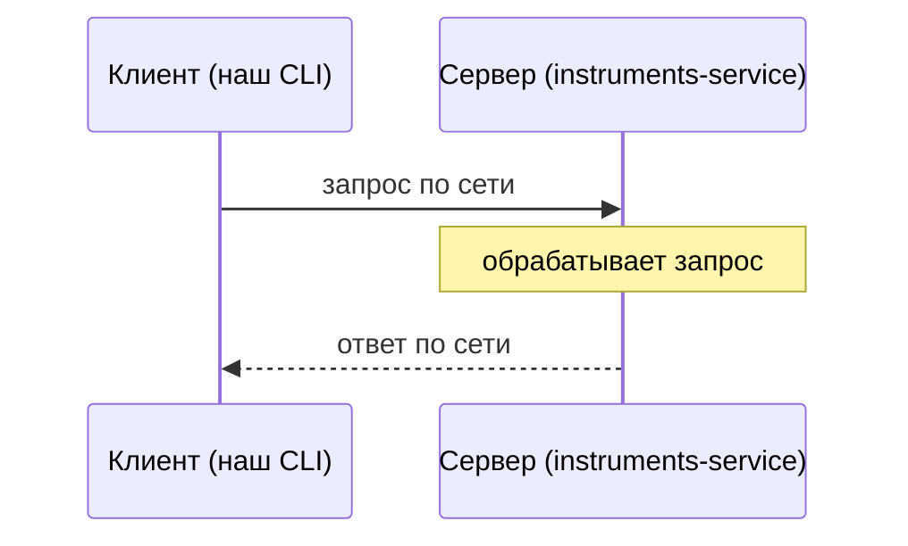
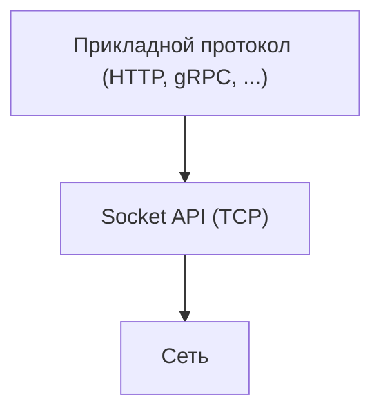
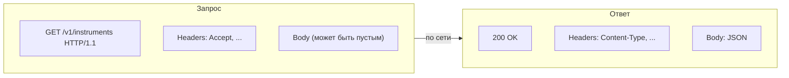

# Основы сетевого взаимодействия

---

## Зачем это вообще нужно

- Котировки и каталог инструментов в проекте — пока заглушка с захардкоженными данными.
- Реальные данные приходят от внешнего сервиса по сети — нужен **клиент**, который их запросит.

> **Сегодня — только клиент.** Сам сервис (`instruments-service`), который эти запросы принимает и
> обрабатывает, — тема следующих семинаров.

---

## Клиент и сервер



- Клиент — тот, кто инициирует обмен.
- Сервер — тот, кто ждёт запросов и отвечает на них.
- Одна и та же программа может быть и тем, и другим (просто сегодня нас интересует только роль
  клиента).

---

## Транспорт: сокеты и TCP



- `Socket`/`ServerSocket` — самый низкий уровень, который обычно видит прикладной код: поток байт
  поверх TCP-соединения (надёжная доставка, порядок байт гарантирован).
- Прикладные протоколы (HTTP и другие) строятся поверх этого транспорта — не изобретают свой способ
  передачи байт заново.

---

## HTTP: запрос и ответ



- Метод (`GET`, `POST`, ...) + путь — что и где запрашиваем.
- Заголовки — метаданные (формат тела, таймауты, авторизация).
- Тело — собственно данные (у `GET /v1/instruments` в этом проекте тела в запросе нет, только в
  ответе).

---

## Как это видно в Java: `HttpClient`

```java
void example() {
    HttpRequest request = HttpRequest.newBuilder()
            .uri(URI.create(baseUrl + "/v1/instruments"))
            .header("Accept", "application/json")
            .GET()
            .build();

    HttpResponse<String> response = httpClient.send(request, HttpResponse.BodyHandlers.ofString());
}
```

- `HttpClient` — объект-клиент, умеет отправлять `HttpRequest` и возвращать `HttpResponse`.
- Детали TCP-соединения, сборки HTTP-сообщения по байтам — внутри `HttpClient`, прикладной код их не
  видит.
- Полная реализация — `HttpClientTInvestApiClient.java`, разбирается на этапе 2.

---

## Сегодня / потом

| Сегодня (семинар 7)                                            | Потом (следующие семинары)                               |
|----------------------------------------------------------------|----------------------------------------------------------|
| Пишем **клиентов** (`HttpClient`, затем Feign/OkHttp на выбор) | Пишем **сервер** — сами принимаем и обрабатываем запросы |
| Моковый сервер — готовая чужая реализация, трогать не нужно    | `instruments-service` разбирается изнутри                |
