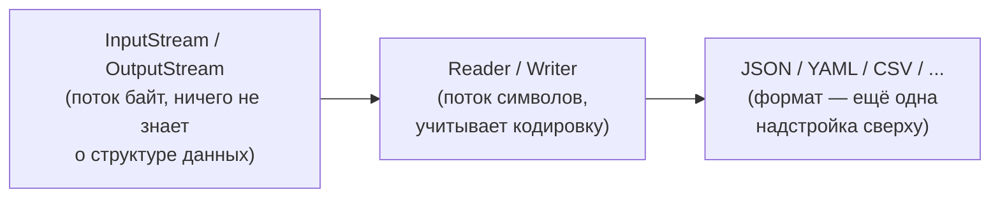

# Форматы данных и файловый ввод-вывод

---

## Зачем это нужно

Дальше нужно самостоятельно выбрать формат файла для хранения котировок — без общего словаря про
`InputStream`/`Reader` и форматы выбор будет наугад.

---

## Байты vs символы



```java
void example() throws IOException {
    try (OutputStream out = Files.newOutputStream(path)) {
        out.write("SBER;250.00".getBytes());
    }
}
```

- `InputStream`/`OutputStream` — самый низкий уровень файлового I/O: сырые байты.
- Текстовые форматы (JSON, YAML, CSV) читаются/пишутся поверх символьных потоков, но в Java-коде
  это обычно скрыто внутри библиотеки (Jackson, Commons CSV сами открывают файл через `Reader`).

---

## Какие бывают форматы

| Формат          | Читается глазами | Для чего обычно                                  |
|-----------------|------------------|--------------------------------------------------|
| Бинарный (свой) | нет              | компактность, максимальный контроль над разбором |
| JSON / YAML     | да               | конфиги, обмен данными между сервисами           |
| CSV             | да (как таблица) | табличные данные, экспорт в Excel                |

---

## Jackson `ObjectMapper`: один API, оба формата

```java
void example() throws IOException {
    ObjectMapper json = new ObjectMapper();
    ObjectMapper yaml = new ObjectMapper(new YAMLFactory());

    json.writeValue(path.toFile(), prices);   // {"SBER":"250.00", ...}
    yaml.writeValue(path.toFile(), prices);   // SBER: "250.00" ...
}
```

- Разница — только в `JsonFactory`, переданной в конструктор `ObjectMapper`.
- Остальной код (`writeValue`/`readValue`) не меняется вообще — формат вывода решает factory, а не
  вызывающий код.

---

## CSV: не велосипед на `split(",")`

```java
void example() throws IOException {
    try (CSVPrinter printer = new CSVPrinter(Files.newBufferedWriter(path),
            CSVFormat.DEFAULT.builder().setHeader("ticker", "price").build())) {
        printer.printRecord("SBER", "250.00");
    }
}
```

- `String.split(",")` ломается, если значение само содержит запятую или кавычки.
- `org.apache.commons:commons-csv` — сторонняя библиотека, которая эти случаи уже решила.

---

## Вопрос группе

Какой формат вы бы выбрали для хранения котировок — и почему? Ответ не раскрываем — к этому
вернёмся на этапе 7, когда формат нужно будет выбрать на практике.
